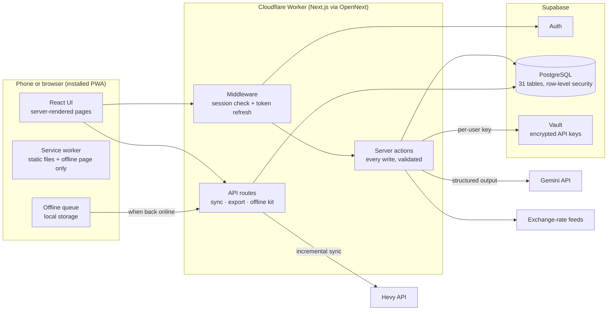

# Life Track

**An installable web app that brings my whole day into one place: workouts synced from the Hevy app, money and savings, food, habits, supplements, body measurements and a weekly coach. Built with Next.js and TypeScript, backed by PostgreSQL on Supabase, and hosted on Cloudflare's edge network.**

`TypeScript` · `React 19` · `Next.js 15 (App Router)` · `PostgreSQL` · `Supabase (Auth, Row-Level Security, Vault)` · `Cloudflare Workers` · `Tailwind CSS` · `PWA / Service Worker` · `REST APIs` · `Gemini API`

> **About this repository.** Life Track is a personal project that I designed, built and use every day. **Its source code, database scripts and keys are private and not published here.** This repository is a technical showcase: what the app does, how it is put together, how the pieces connect, and the engineering problems I solved along the way. Everything below describes the real, working application.

## At a glance

| | |
|---|---|
| Code | about **26,000 lines of TypeScript** in 152 files, plus about **2,200 lines of SQL** |
| Screens | **20 screens** (Today, Log, Training, Food, Money, Savings, Habits, Supplements, Body, Coach, Settings and more) |
| Database | **31 PostgreSQL tables**, every one protected by **row-level security** |
| Integrations | **Hevy** workout API (incremental sync), **Gemini** API (structured output), two live exchange-rate feeds |
| Runs on | Cloudflare Workers through the OpenNext adapter, placed in the same region as the database |
| Works offline | installable on a phone; logging still works with no connection and syncs itself later |
| Releases | shipped in **9 milestones** and then versioned releases up to **1.4.1**, each with its own patch notes |

## What it does

- **Today.** One screen for the day: habits and supplements to tick (for today or yesterday), workouts this week, budget left, weight trend, the current phase (bulk, cut, maintain, recovery) and the coach's latest suggestion. Every card can be reordered, hidden or collapsed, and the app opens exactly as I left it.
- **Training.** Workouts, exercises and sets come in automatically from Hevy. The app picks my main lifts, estimates each one's 1-rep max, charts 12 weeks of progress, marks lifts as progressing or stalled, rates them against strength standards (7 barbell lifts plus 72 more tables for dumbbell, machine and cable lifts), counts weekly sets per muscle against a target range, and shows a calendar of training days.
- **Money.** Expenses and income in shekels, dollars and dinars, converted at the **live exchange rate of the day each entry was made**. Monthly budgets per category become daily, weekly or monthly allowances. Recurring payments log themselves on their due dates.
- **Savings.** Savings sections with yearly goals or target dates (the monthly target re-plans itself after good or short months), foreign-currency holdings, and investments with a payment schedule, value history, profit and average yearly return.
- **Quick log.** Type or dictate one sentence ("gas 300 gift 50"). Gemini turns it into separate, structured entries; I check each one before anything is saved.
- **Food.** Paste a meal's nutrition breakdown and a parser **written without AI** reads 14 values (bold text, bullets, tables, kJ, ranges, mg/g/mcg). The app checks that calories, protein, carbs and fat agree with each other, and shows daily "battery" bars against my targets. Suggested targets come from standard formulas (Mifflin-St Jeor, or Katch-McArdle when body fat is known), training frequency and phase, and the card explains every step.
- **Habits and supplements.** Four habit types (yes/no, X times in Y days, quantity, avoid), habit strength, streaks, a year calendar and charts; some habits fill themselves in from Hevy workouts or from the supplements taken. A CSV import reads another habit app's export, checked against a real export of 4,194 days.
- **Body.** Weigh-ins, body fat, 16 tape measurements with trend charts, and a pain log with warning signs and a summary for a doctor.
- **Coach.** Every Friday evening (or on demand) it reviews the week and makes **at most one suggestion per category** (training, diet, supplements, recovery). **Fixed rules decide; the AI only words the summary.** I accept, decline or postpone; follow-ups record whether a change worked, and moves that didn't work aren't suggested again. An accepted training change creates a new, dated folder of adjusted routines in Hevy, so the current routines are never touched.
- **Paste a day.** Paste a day's notes ("creatine yes, water 2.5 L, weight 71.4, lunch 45") and the app sorts each line into habits, supplements, weight, savings or budget, matching my own names even with a typo, and shows a preview before saving. Pasting the same text twice can never create duplicates.

## How it works

1. **Requests.** Every page request passes through middleware that checks the Supabase session and refreshes the login token early, so the new cookies always reach the phone. The app layout checks the user a second time on the server.
2. **Reads and writes.** Pages are rendered on the server. Every change goes through a **server action** that validates its input again on the server, even when the form already checked it in the browser.
3. **Data isolation.** The browser only holds the *publishable* Supabase key. Each table has row-level security policies of the form "only rows where `user_id` is the signed-in user", so even a hand-crafted request can only reach its own rows.
4. **Third-party APIs.** Hevy and Gemini are called only from the server, with each user's own key, read from Supabase Vault for that request and never sent to the browser.

More detail: [Architecture](docs/architecture.md) · [Syncing and offline mode](docs/sync-and-offline.md) · [Security and privacy](docs/security-and-privacy.md)

## Engineering highlights

- **A sync that can't lose a change.** The Hevy sync reads Hevy's change feed (new, edited and deleted workouts) in small steps that fit inside the Worker's limit of 50 outgoing requests per call. It keeps a resume point and only moves its "synced up to" mark after the last page, so closing the app halfway never skips an event. A weekly full check repairs any gap, and every run is written to a visible sync log.
- **Offline logging that never saves twice.** With no connection the app opens a page for ticking habits and supplements and adding meals, money and weigh-ins. Entries wait in a queue on the phone, each with its own client id, and go up in small batches when the connection returns, so a retry can never create a duplicate.
- **AI kept on a short leash.** Gemini answers in a fixed JSON schema and **every field of every item is validated** before it reaches the screen; nothing is saved until I confirm. In the coach, rules decide and the model only writes the wording, so every suggestion can be traced to a rule. Gemini only receives the sentence typed, the category names and the date.
- **Keys handled properly.** Each user's Hevy and Gemini keys live in **Supabase Vault**, saved and read only through three database functions that act on the signed-in user's own key. I tested it in a rolled-back dry run on the real database with two users: one user could not read, replace or remove the other's key.
- **Fast from far away.** The Worker runs in the same region as the database, so each database call takes a few milliseconds instead of about 200. Pages fetch the login, settings and data together instead of one after another: Today went from **8 sequential database round trips to 2**, and Money from 5 to 2.
- **Money maths that stays true.** Foreign entries are converted at the live rate of their own day (with fallbacks to the last answer, then to saved rates). Changing an investment's monthly payment counts from that month on and never re-prices months already paid.
- **Careful UI.** Dark gray and orange theme, fields at 16 px so phones don't zoom, a reusable drag-to-reorder engine (grips, press and hold, arrow keys, auto-scroll), collapsible cards, filters that don't flood the back button, and layouts checked down to 320 px wide.
- **Reviewed and hardened.** I ran a full code review of the app and fixed all **52 findings** in one release, from budget weeks that cross a month end to double saves, request timeouts and login cookies that page scripts could read.

## Case study: the logins that kept disappearing

**Problem.** On the phone the app sometimes sent me back to the login screen for no clear reason, and its error screen's "Try again" button repeated the same error forever.

**What was happening.** Two things. When a page answered with a redirect, the refreshed login cookies were dropped from the response, so the phone never received them. And a short Supabase outage looked the same as "not signed in", so the app logged me out.

**Fix.** The token is now refreshed early, in the middleware, so its new cookies are part of every response. A short outage no longer logs anyone out, a signed-out session says so and returns to the same page after logging in, an app left open across an update reloads itself once, and auth failures are written to the server logs with their own prefix so they can be found. "Try again" now reloads the page's data instead of repeating the failed render.

## Tech stack

| Layer | Choice | Why |
|---|---|---|
| Frontend | React 19, Next.js 15 App Router, Tailwind CSS 4 | server-rendered pages and server actions keep the data on the server |
| Language | TypeScript (strict) | one language for UI, server and data shapes |
| Database | PostgreSQL on Supabase | relational data (workouts → exercises → sets), row-level security, Vault |
| Auth | Supabase Auth with cookie sessions | sign-ups switched off, password change needs the current password |
| Hosting | Cloudflare Workers (OpenNext adapter), deploys from Git | every push to the main branch redeploys |
| Mobile | Web app manifest + service worker | installs on Android like a native app, opens offline |

---

Ali Siaj · [LinkedIn](https://www.linkedin.com/in/ali-siaj) · Other projects: [Swarm Wrath](https://github.com/Ali-Siaj/swarm-wrath) · [Vision Automation Bot](https://github.com/Ali-Siaj/vision-automation-bot)
