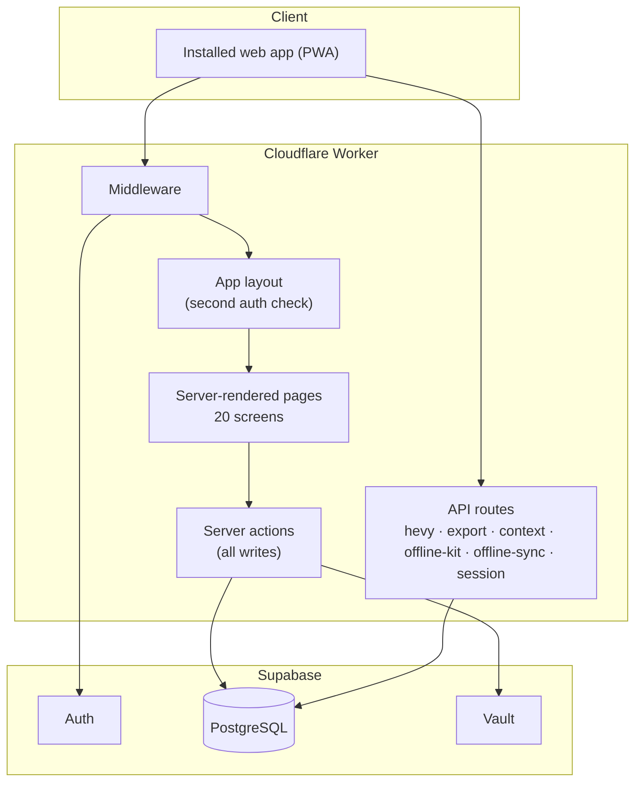
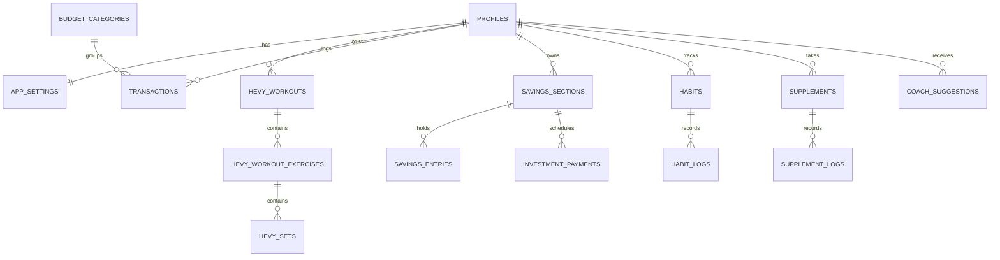

# Architecture

[← Back to the overview](../README.md)

## The big picture

Life Track is one Next.js application. The same codebase renders the pages, runs the server logic and serves the small API the phone uses. It is compiled for Cloudflare Workers with the OpenNext adapter, so it runs on Cloudflare's network with no server of my own to manage. Every push to the main branch rebuilds and redeploys it.

## Layers

| Layer | What lives there |
|---|---|
| **Pages** (`app/(app)/…`) | Today, Log, Training (and one page per lift), Food, Money, Savings, Habits (and one page per habit), Supplements and their history, Body and the pain log, Coach, Profile, Settings, Customization, Patch notes |
| **Server actions** | one module per area (money, savings, food, habits, body, coach, settings). Each one checks the user, validates every field and writes only that user's rows |
| **API routes** | the Hevy sync steps, the full data export, the "Copy for Gemini" context, and the two endpoints used by offline mode |
| **Domain logic** (`lib/`) | pure TypeScript modules: budget periods, savings plans, investment payment schedules, habit strength and streaks, strength standards, nutrition parsing, target suggestions, the coach engine, exchange rates, time zones |
| **Components** | reusable UI: collapsible cards, a drag-to-reorder list, trend charts, period navigation, confirm-delete pop-overs, the offline logger |

Domain logic is kept apart from the database and the UI, so the maths (for example, what a week's budget is when the week crosses a month end) lives in one place and every screen uses the same answer.

## Data model

31 PostgreSQL tables, grouped by area. Every table has a `user_id` column and row-level security policies that limit reads and writes to the signed-in user.

| Area | Tables |
|---|---|
| Account | profiles, app_settings, page_layouts, user_keys, server_key_users |
| Training | hevy_workouts, hevy_workout_exercises, hevy_sets, hevy_exercise_templates, workout_overrides, sync_state, sync_runs |
| Money | transactions, budget_categories, recurring_items |
| Savings | savings_sections, savings_entries, investment_values, investment_payments |
| Daily | habits, habit_logs, supplements, supplement_logs, nutrition_logs |
| Body | body_metrics, body_measurements, pain_logs, phases |
| Coach | coach_rules, coach_reviews, coach_suggestions |

Database changes ship as numbered, re-runnable SQL update scripts (safe to run twice), plus one script that builds the whole database from scratch. When a release needs a database step and it hasn't been run yet, the app keeps working and the affected screen says which script to run.

## Performance

- **Placement.** The Worker is pinned to the same cloud region as the database, so each query is a few milliseconds instead of about 200 ms across the world. Only the first hop, from the phone to Cloudflare, is long.
- **Parallel reads.** Pages ask for the session, settings and data together. Today went from 8 sequential database round trips to 2, and Money from 5 to 2.
- **Read once.** Settings are read once per request and shared by everything that needs them; big history tables are fetched in parallel pages, and history screens load only the days they show.
- **Platform limits respected.** A Worker call may make at most 50 outgoing requests, so long jobs (the first Hevy import, saving a new order for a long list, offline uploads) are split into bounded steps.

## Releases

The app grew in 9 milestones (skeleton and login, Hevy sync, quick log and money, habits and supplements, body, savings, training analysis, customization, the coach) and then in versioned releases up to 1.4.1. Each release has plain-language patch notes inside the app, and the version number is shown on Today so I can tell which build is running on the phone.
