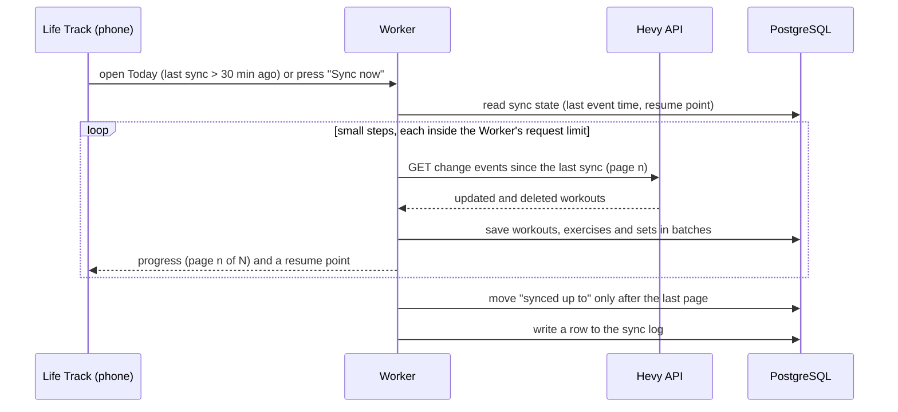

# Syncing and offline mode

[← Back to the overview](../README.md)

## Hevy sync: how the connection works

Hevy is the app I log my workouts in. Life Track connects to Hevy's REST API with my own API key, which is stored in Supabase Vault and used only on the server.

**Design choices**

- **Change feed, not a full download.** After the first import, the app reads only Hevy's events (new, edited, deleted workouts) since the last sync.
- **Small, resumable steps.** A step reads a bounded number of pages and saves them together in a handful of database calls, well inside the 50 outgoing requests a Worker call may make. The phone calls again with the resume point until the sync is done, so a long history imports without a timeout.
- **Nothing skipped if the app closes halfway.** The "synced up to" time moves only after the last page. A resume point older than an hour is not trusted and the sync starts the changes again from page 1, which is safe because nothing was marked as synced yet.
- **A weekly full check.** Once a week the sync compares everything and repairs any gap. The result of every run (ok, repaired, failed, with the reason) is visible on the Training screen.
- **My corrections win.** "Workouts this week" can be corrected by hand, and the sync never overwrites the correction.
- **Writing back to Hevy, safely.** When I accept a training suggestion from the coach, the app creates a new Hevy folder named with the date that holds adjusted copies of my routines. Existing routines are never edited.

## Gemini: structured output, validated

Quick log and Paste a day send short text to the Gemini API from the server and ask for a reply in a fixed JSON schema (one item per payment: amount, currency, category, note, date). The reply is treated as untrusted input: every field of every item is validated, anything invalid is dropped or flagged, and I confirm the entries before they are saved. Requests have timeouts, and when Google refuses a key the error shows Google's reason (never the key). A "Test Gemini key" button checks the key and model with a model lookup, which uses no generation quota.

## Exchange rates

Dollar and dinar amounts are converted to shekels with two free feeds: today's rate (looked up about once a day and kept in between) and historical rates for back-dated entries (the dinar follows its dollar peg). If a lookup fails the app falls back to the last answer, then to the rates saved in Settings, and the screens say when saved rates are in use. Each lookup gives up after 6 seconds.

## Offline mode

- **The service worker caches only static files** (code, fonts, icons) and the offline page, which is the same for every user. It never caches personal data or a signed-in page.
- **The phone keeps only what the forms need.** A small "kit" with the names of my habits, supplements and categories, my time zone, and today's ticks. No history. Logging out removes it.
- **Idempotent upload.** Every queued entry carries its own id. The server saves an entry at most once, so a retry after a dropped connection can never create a duplicate.
- **Bounded batches.** Six entries per request, because each one costs a few database calls and a Worker call may make at most 50.
- **New versions.** The offline page and the files it needs are saved again for every new version, and older copies are deleted only once the new copy is complete.
